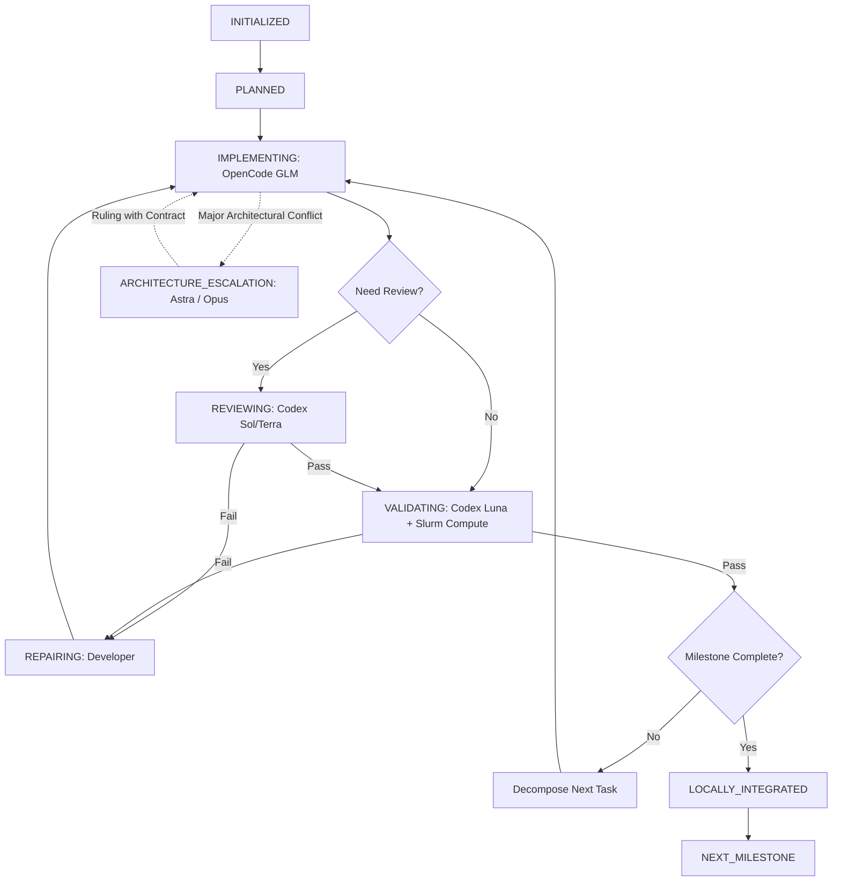

# ProkaDiff 多模型协同持续开发策略规范

> 本规范参考 `/hpcfs/fhome/caizhh/Desktop/03_Tool_Development/01_fastBact` 项目经过实战验证的多模型协同工程体系，全面对齐通用长周期自主开发规则 **Multi-AI Collaboration V3.2** (`~/.config/ai-collaboration/POLICY.md`)，为 ProkaDiff 制定规范化、可追溯、可持续的协同开发策略。

---

## 1. 核心原则与架构体系

### 1.1 唯一通用规范与分层设计
- **通用协作规则**: 全局单一真实信源为 `~/.config/ai-collaboration/POLICY.md`（Multi-AI Collaboration V3.2），禁止在项目内部复制或维护平行的通用角色规范副本。
- **项目科学与工程契约**: 专属于 ProkaDiff 的科学模型、算法不变量（Clean-room vs breseq、Path B 引擎、noodles BAM I/O、突变分类次序等 Rules 1–15）及里程碑目标，严格维护在本项目专属文档中（`AGENTS.md`、`DEVELOPMENT_PLAN.md`、`docs/schema.md`、`docs/parity.md`）。
- **去中心化脚本清理**: 彻底废除本地临时守护脚本（如历史 `parity_closure_supervisor.py --loop`），杜绝失控的后台轮询进程，所有长周期自治开发均由 Controller 基于标准 CLI 调度并在会话与中断恢复中推进。

### 1.2 固定角色与模型矩阵

| 角色 | 平台 / 工具 | 模型 / CLI ID | 核心职责与边界 |
| --- | --- | --- | --- |
| **Controller** (`AUTONOMOUS_EXECUTION_CONTROLLER`) | **Antigravity CLI** (`agy`) | **`gemini-3.8-flash-medium`** | **唯一默认主控**。负责里程碑分解、严格顺序调度 Developer、组织 Review/Validation 门禁、Slurm 计算作业编排、工作树协调、状态持久化与自主推进。严禁任何 Worker 擅自篡夺 Controller 身份。 |
| **Developer P1** (`PRIMARY_IMPLEMENTATION_ENGINEER`) | **OpenCode CLI** | **`zhipuai-coding-plan/glm-5.3-flash`** (常规) / **`glm-5.3`** (复杂) | 优先开发主力。负责常规工程、代码编写、单元测试编写与局部缺陷修复。优先消耗已配置的智谱 Coding Plan 额度。 |
| **Developer P2** (`BACKUP_IMPLEMENTATION_ENGINEER`) | **Cursor CLI** (`cursor-agent` / `agent -p`) | **`grok-4.7-high-fast`** (常规复杂) / **`grok-4.7-xhigh-fast`** (超高难度) | 备用实施主力。仅在 GLM 额度明确耗尽或多轮尝试确实无法推进时按规则升级启用。禁止反向启动其他 Agent。 |
| **Independent Reviewer** | **Codex CLI** (`codex exec -s read-only --ephemeral`) | **`gpt-6.1-terra`** (常规审查) / **`gpt-6.1-sol`** (核心正确性审查) | 独立只读代码与算法审计。确保实施者与审查者严格解耦 (`Implementer ≠ Reviewer`)。 |
| **Validator** | **Codex CLI** (`codex exec -s read-only --ephemeral`) + 确定性工具 | **`gpt-6-luna`** + `cargo test` / `pytest` / Slurm 验收脚本 | 质量门禁与事实裁决。必须基于真实退出码、日志和可复现证据，不得以模型纯推理代替实际执行。 |
| **Technical / Scientific Architect** | **Codex CLI** / **Claude Code CLI** | **`gpt-6-astra`** (工程/算法架构) / **`claude-opus-5-5`** (科学契约与生物学真值) | 高级架构裁决。在用户既有授权内解决重大设计冲突、数据结构选型与不变量修订。Opus 遵循 $5.00 累计项目软预算及 $10.00 账户保留金。 |
| **Final Authority** | **人类用户** | `FINAL_AUTHORIZATION_AUTHORITY` | 保留付费预算扩充、科学契约变更、远程 `git push`、主分支合并及正式 Release 发布的最终授权。 |

---

## 2. 借鉴 fastBact 的标准化工程交付体系

参考 fastBact 在 F24、F25、F26、F27 里程碑中的高成熟度交付模式，ProkaDiff 全面推行**四位一体标准文档化交付**：

### 2.1 里程碑标准四件套
每个重要开发阶段必须建立可审计的生命周期文件：
1. **`<MILESTONE>_ARCHITECTURE_AND_ACCEPTANCE_CONTRACT.md`**：
   - 明确阶段目标、科学契约、明确排除项、硬性不变量与验收门禁（Gate A–Gate G）。
2. **`<MILESTONE>_TASK_LEDGER.md`**：
   - 原子化任务列表、前置依赖、负责人角色、当前状态与完成哈希。
3. **`<MILESTONE>_WORKER_DISPATCH_LEDGER.md`**：
   - 记录每一次外部 Worker 调度的 `TASK_ID`、分配模型、工作树路径、退出码、消耗费用及产出物。
4. **`<MILESTONE>_FINAL_INTEGRATION_REPORT.md`**：
   - 阶段结束时由 Codex Sol / Luna 独立审计通过后生成的最终集成报告，记录回归测试结果、二进制 SHA-256、无损合并证明及遗留事项。

### 2.2 状态追踪与交接机制（`HANDOFF.md` & `ACTIVE_TASK.md`）
- 规范目录结构为：
  - `docs/development/HANDOFF.md`: 记录里程碑演进的完整历史台账与版本交接快照。
  - `docs/development/ACTIVE_TASK.md`: 记录当前实时进行中的任务、活跃 Worker、待解决缺陷及即时下一步指令。
  - 根目录保留指向 `docs/development/` 对应文件的软链接或同步镜像，方便各平台 CLI 快速定位。
- 遵循最小可恢复上下文集：
  - `CURRENT_PROJECT`: ProkaDiff
  - `CURRENT_MILESTONE`: 当前阶段编号及名称
  - `CURRENT_STATUS`: 当前状态机状态
  - `ACTIVE_WORKTREE`: 物理隔离的当前工作树路径
  - `SOURCE_SHA`: 当前基线 Commit SHA
  - `ACTIVE_WORKER`: 当前持有写入权的 Worker
  - `COMPLETED_GATES`: 已通过的门禁列表
  - `OPEN_FINDINGS`: 未关闭的缺陷或审查发现
  - `LATEST_VALIDATION_EVIDENCE`: 最新验证命令与 Slurm Job ID
  - `REMAINING_BUDGET`: 预算余量（Claude / 算力）
  - `NEXT_ACTION`: 下一步具体行动

---

## 3. 标准自主执行与循环机制

### 3.1 生命周期状态机


### 3.2 自动修复三轮上限准则
- 针对同一重大算法根因，实施 Worker 最多允许进行连续 **3 轮** 具有实质差异的修复尝试。
- 若 3 轮尝试后门禁依然失败，禁止盲目无限重试，自动触发 `ARCHITECTURE_ESCALATION`，将最小反例与执行日志上报给 Architect（Astra / Opus）重新裁决契约，裁决后开启新的受控修复周期。

---

## 4. Git 与工作树安全隔离

1. **单写入者原则 (`Single-Writer Worktree`)**:
   - 同一工作树在同一时间严禁多个 Worker 同时写入。
   - 复杂功能实现或长周期重构，必须在独立分支和专用 worktree（如 `../04_ProkaDiff-m7-worktree`）中开展，主工作树保持清洁。
2. **禁止破坏性 Git 操作**:
   - 严禁执行 `git clean -fd`（避免抹去未跟踪的重要测试输出）。
   - 严禁执行 `git reset --hard`（保护工作区未提交成果）。
   - 严禁无授权 `git push --force` 或向远程主分支推送代码。
3. **本地渐进提交**:
   - 鼓励在开发分支上以规范的 Conventional Commits 格式进行原子化本地提交，记录每一次通过门禁的进展。

---

## 5. HPC Slurm 算力与验证规范

遵守 ProkaDiff 既定科学规则（Rule 11）：
1. **登录节点与计算节点严格分离**:
   - **登录节点（禁止重型任务）**: 严禁在登录节点运行 `cargo build`、`cargo test`、`pytest`、`bowtie2`、`breseq`、BAM I/O、大规模索引构建及性能基准测试。仅允许 `git status`、任务编排、元数据查看及轻量检查。
   - **计算节点（Slurm 分区调度）**:
     - **`qfree` 分区**: 适用于日常单元测试、交互式编译调试、短时集成验证脚本。
     - **`qcpu_18i` 分区**: 适用于全基因组重测序对齐（WGS）、复杂结构变异基准评估、breseq Oracle 对照全流程测试。
2. **作业元数据完整记录**:
   - 每一个关键测试或基准作业必须记录：`SLURM_JOB_ID`、分配节点、CPU/内存规格、精确命令、退出码、输出路径及日志文件哈希。
3. **真实性原则**:
   - 严禁伪造测试通过、加速比或内存占用数据。缺失外部依赖或环境时，停止该层级验证并标记为 `NOT_EVALUABLE`，保留纯单元测试验证范围。

---

## 6. 预算、额度与调用安全

1. **智谱 Coding Plan (GLM)**:
   - 作为主力编码工具，常规使用 `glm-5.3-flash`，高难度算法使用 `glm-5.3`。
   - 调度前通过 `python3 ~/.local/share/ai-routing/quota_manager.py status` 确认可用性。
2. **Cursor Pro (Grok)**:
   - 作为备用工具，严禁由 Grok 发起跨平台嵌套调用。
   - 保持环境无头执行安全性，杜绝不受控的后台代理。
3. **Claude Opus 5.5 架构调用**:
   - 遵循用户已授权的 Standing Authorization。
   - 仅限 Controller 针对科学契约、真值仲裁等高级问题调用，单次审查前校验 `claude-budget.json`，确保在 $5.00 累计硬顶及 $10.00 保留金内。
   - 调用结果及时同步至 `.prokadiff/claude_opus_ledger.tsv`。

---

## 7. 用户介入红线

除以下 7 类触发条件外，Controller 在既有里程碑授权内完全自主闭环：
1. 涉及修改已冻结的核心科学契约、研究目标或生物学真值（如 PRJNA884016 隔离决议）。
2. 出现重大科学不确定性，现有实验数据无法自洽，必须由研究者提供新数据或湿实验判定。
3. 模型 API 费用突破既定授权边界（如 Claude 预算超额）。
4. 超出 HPC Slurm 既有计算配额或需要专属认证凭据。
5. 需要执行不可逆的破坏性 Git 操作或向远程仓库公开 push / tag / release。
6. Architect 之间存在无法依靠确定性测试消除的根本理论分歧。
7. 所有安全可行的工程修复路径均已尝试完毕且仍处于完全阻断状态。

---

## 8. Native Controller Recovery Schedule (原生 5 分钟恢复检查机制)

依据 Multi-AI Collaboration V3.2 第 13.4 节调度生命周期规范，ProkaDiff 采用 Antigravity CLI 原生 `/schedule` 机制建立 5 分钟定时恢复巡检，彻底杜绝外部失控守护进程。

### 8.1 机制定义与边界
1. **`/goal` 与 `/schedule` 双轨协同**:
   - `/goal` 负责常规连续自主开发推进；
   - `/schedule`（Cron: `*/5 * * * *`, `IsDaemon: true`, `MaxIterations: unlimited`）负责每 5 分钟的轻量级定时恢复检查。
2. **事件驱动优先与恢复检查后备**:
   - Worker 完成事件应优先立即触发下一轮 Controller 决策；
   - `/schedule` 用于恢复漏处理的完成事件、发现失效/挂起任务和重新检查阻塞依赖。
3. **调度权唯一与防重入原则**:
   - Schedule **不直接成为第二调度所有者**，其触发通知直接由唯一 Antigravity Controller 接收并执行判断；
   - Schedule **严禁与正在执行的 Controller 决策并发派发相同任务**。若当前 Controller 正在处理有效派发或执行中，本轮巡检仅记录心跳已发生，不启动竞争性调度。
4. **铁律继承与约束不变**:
   - 原有科学契约（Rules 1–15）、Claude $5.00 累计硬顶、Slurm 计算节点专属规则、Git 安全（禁止未经授权的 force-push/reset/clean）与单 Writer 工作树约束全部保留。

### 8.2 每 5 分钟执行的检查维度
- **A. Controller / Task Health**: 读取当前里程碑任务状态（`READY`, `RUNNING`, `WAITING_WORKER`, `WAITING_REVIEW`, `WAITING_SLURM`, `BLOCKED_EXTERNAL`, `BLOCKED_AUTHORIZATION`, `COMPLETE`）。若存在已授权 `READY` 任务且无活动运行 Worker，立即恢复 Controller 决策并启动下一任务。
- **B. Worker / Reviewer Status**: 检查 OpenCode GLM、Cursor Grok、Codex、Claude 及 Slurm 作业。若发现 Worker 已完成但台账仍显示 WAITING，立即收集退出码、验证交付件、更新台账并推进后续。若 Worker 正常运行，不重复启动；若连续两轮（>= 10 分钟）无进展证据，标记 `SUSPECTED_STALL` 并做详细诊断，不得仅凭沉默终止合法长任务。
- **C. Quota and Failover**: 读取 `~/.local/state/ai-routing/quota-state.json` 与 `quota_manager.py`。GLM 明确限流时，自动无缝切换至 Cursor Grok，保留原 Task ID，不消耗常规技术修复轮数，不等待 GLM 恢复才继续开发。若审查/架构角色不可用，转而推进其他独立的 READY 任务，严禁绕过必要独立审查。
- **D. Milestone Progress**: 检查当前 Stage Roadmap 与 Task Ledger。当前已进入 M10 多克隆批次审计模式，优先推进实际 `M10-T02` 至 `M10-T06` 工作包，同时严格保持 G1 历史科学限制，不得错误提升严格门状态。

### 8.3 运行日志记录规范
每轮巡检在 `.prokadiff/controller_recovery_audit.log` 记录单行轻量证据：
```json
{"check_timestamp": "2026-11-04T15:05:00+08:00", "schedule_iteration": 1, "current_milestone": "M10", "current_task": "M10-T02", "controller_status": "DECIDING", "worker_status": "IDLE", "last_progress_timestamp": "...", "detected_event": "READY_TASK_TRIGGERED", "action_taken": "DISPATCH_M10_T02", "next_task": "M10-T02"}
```
无异常且有 Worker 正常运行时记录 `HEALTHY` 简明结果，不每 5 分钟生成冗余 Markdown 报告。

### 8.4 连续开发推进与授权核验规范 (Continuous Progression & Authorization Verification)
1. **自动前向推进与授权核验**:
   - 当任一阶段（如 M10）的所有适用门禁通过并被独立签收后，Controller 必须立即自动比对 `DEVELOPMENT_PLAN.md`、`STAGE_ROADMAP.md` 及用户初始指令，核验下一阶段是否已被授予开发权限。
   - **下一阶段已授权**：立即执行任务矩阵分解，将首个工作包标记为 `READY`，并自主启动开发，严禁在无技术障碍或授权障碍时停顿等待。
   - **下一阶段未授权**：明确标记状态为 `BLOCKED_AUTHORIZATION`，向用户提交一份具体的下一阶段实施方案（包含科学范围、生产改动与算力需求），等待用户单次审批。
   - **存在其他已授权 READY 任务**：若路线图中有其他互不依赖的就绪工作包，优先继续推进，不因主干阻断而暂停全局。
   - **禁止死循环空转**：**严禁默认使用 `AWAITING_USER_DIRECTIVE` 代替授权核验**，严禁在没有实际任务且处于阻断状态时连续输出无实质进展的空转心跳。

### 8.5 调度生命周期优化与休眠规则 (Schedule Lifecycle & Dormancy)
1. **开发态活跃**: 开发任务进行中，保持 `/schedule` 每 5 分钟巡检活跃，监控在途 Worker、Slurm 批处理与进度卡死。
2. **阻断态休眠**: 当所有已授权任务均已完成且系统确认为 `BLOCKED_AUTHORIZATION` 时，Controller 必须**主动调用 `manage_task kill` 暂停高频定时巡检任务**，彻底停止无意义的模型 API 消耗，避免浪费 Gemini 周度额度。
3. **唤醒态重启**: 仅当用户输入明确的新授权指令、恢复开发或激活新里程碑时，由 Controller 重新注册原生 `/schedule` 检查。
4. **铁律禁止**: 严禁编写任何外部 Python/Shell supervisor、watchdog 守护进程，严禁引入第二个活跃 Controller。

---

## 9. 多模型主控接管与故障转移机制 (Multi-Model Controller Failover)

1. **唯一默认主控**:
   - Antigravity CLI / Gemini 3.8 Flash Medium (`AUTONOMOUS_EXECUTION_CONTROLLER`) 为 ProkaDiff 唯一默认智能 Controller。
2. **额度水位监控与优雅交接**:
   - Controller 持续监控自身模型额度水位（参考 `~/.local/state/ai-routing/quota-state.json` 及 API 响应状态）。
   - 当 Gemini 额度接近保护阈值（或遭遇持续性服务端限流）时，当前 Controller 必须在**安全的任务边界**（如任务已完成并记账、或处于事务完整检查点）完成交接记录（更新 `HANDOFF.md` 与 `ACTIVE_TASK.md`）。
   - 将主控职责无缝交接给 OpenCode CLI（模型优先：`glm-5.3`）。
   - 若 GLM 亦不可用，可进一步降级交接给 Cursor Pro (`grok-4.7-high-fast`)。
3. **全局排他性约束**:
   - 任何时刻**必须严格保证仅有一个活动 Controller**。
   - 交接前必须确认旧 Controller 已进入休眠或释放调度权，严禁双 Controller 同时并发决策或向同一工作树并发派发 Worker。
